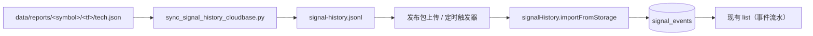
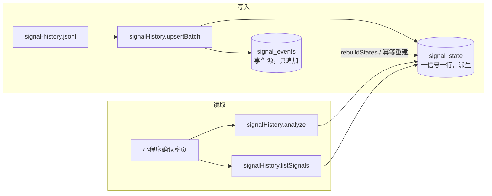

# 买卖点确认率分析（Spec + Design）

> 状态：**已按 §0 推荐方案实现（待复核）**（2026-11-20）
> 实施说明：P0a + P0b 代码已落地；`signal_state` 集合创建、索引与 `rebuildStates` 迁移仍需按 §10 在云环境执行。
> 目标页面：`westock/miniprogram/pages/signalConfirmation/index`
> 数据源：CloudBase `signal_events` → 新增派生集合 `signal_state`
> 关联文档：
> - [signal-realtime-lifecycle-design.md](signal-realtime-lifecycle-design.md) §6.2（信号迁移历史存储）
> - [buy-sell-multi-level-spec.md](buy-sell-multi-level-spec.md) §2.8.3–§2.8.5（forming / confirmed / invalidated 与六字段）
> - `westock/cloudfunctions/signalHistory/README.md`（现有云函数与集合）
> - `stock/scripts/sync_signal_history_cloudbase.py`（事件采集端）
>
> 本文只定义口径、数据模型、接口与页面方案。**评审通过后再改代码。**

---

## 0. 需要你确认的口径（请逐项确认）

| # | 决策 | 推荐方案 | 备选 / 说明 |
| --- | --- | --- | --- |
| 1 | 确认率主口径 | `确认率 = confirmed / (confirmed + invalidated)`；`confirmed` = 曾确认且**未被证伪**；`confirmed → invalidated` 计入失效 | 备选：曾确认率（只要曾确认就计入分子）。推荐值同时提供扩展指标 `everConfirmedRate`，但不作为主卡片 |
| 2 | `resolved_at` 取哪一次迁移 | **首次解决时间**：取 `confirmed_at` / `invalidated_at` 中较早者（仅一个时取该值）。即“形成 → 首次确认/失效”的用时；确认后失效的信号仍按首次确认计时 | 备选：按最终失效计时（确认后失效会显著拉长存续时长）。推荐“首次解决”，与你给出的“转入 confirmed / invalidated 的时间”一致 |
| 3 | 时间范围按什么时间归属 | 按 `forming_at`（首次形成）做 cohort；筛选、趋势分期都用它 | 备选：按 `resolved_at` 归属。推荐 forming_at，便于看“某批信号最终兑现质量” |
| 4 | 历史信号缺 `forming_at` | **排除出统计**，并用 `dataQuality.excludedMissingFormingAt` 计数提示；不伪造、不用 confirmed_at 回填 | 备选：全部范围下保留但时长记 `--`。推荐排除，保证趋势/中位数口径一致 |
| 5 | 数据架构 | 新增 `signal_state` 派生集合（一信号一行），由 `signalHistory` 云函数维护；页面只调云函数读接口 | 备选：前端聚合 `signal_events` / 发布包预计算。事件多行且无法稳定游标分页，不推荐 |
| 6 | 趋势图 | 原生 Canvas 2D；堆叠柱（确认/失效）+ 确认率折线 + 4 期样本加权 MA；自动日/周/月 + 手动覆盖 | 不引入 ECharts（小程序包体与构建成本） |
| 7 | `forming_dropped` / `superseded` 审计事件 | **本期一并纳入**（P0b）：避免“进行中”被自然消失的 forming 永久抬高；`superseded` 仍按确认成功计 | 若想缩小首期范围，可延后到 P1；页面上“进行中”可能偏高 |
| 8 | 明细交互 | 行内展开核心字段 + 跳个股详情；不新建“信号详情页” | 备选：独立详情页。推荐行内展开，少一次跳转 |

> 如果以上 8 项都按推荐方案，回复“按推荐方案实现”即可；有不同意见直接指出编号。
>
> **本次自动执行说明**：在无法即时获得确认的情况下，已按上述推荐方案落地 P0a + P0b；如需调整某一项，指出编号即可按文档回退/修改对应实现。
>
> 术语：**P0 = 本期必须**，**P1 = 后续优化**；P0a / P0b 的拆分见 §10。

---

## 1. 背景与目标

### 1.1 现状

- 「买卖点」页（`westock/miniprogram/pages/buyPoints/index`）只展示**当前发布包**里的最近信号，回答“现在有哪些买卖点”。
- 信号迁移历史已落到 CloudBase `signal_events`（`forming` / `confirmed` / `invalidated`，一条 = 一次迁移，见 design §6.2）。
- 目前没有任何页面回答：
  - 历史上发出的信号，最终有多少确认、多少失效？
  - 从首次形成到确认/失效通常要多久？
  - 哪类点、哪个周期、哪个方向的确认率更高？
  - 确认率随时间在变好还是变差？

### 1.2 目标

新增一个只读的「买卖点确认率分析」页：

1. 顶部时间范围 + 周期 / 类型 / 方向多选筛选。
   - 分析范围 = `signal_events` 已入库的标的（当前由持仓发布链路写入）；本期不做个股搜索筛选（P1）。
2. 6 个统计卡：信号总数、确认数、失效数、进行中、确认率、中位存续时长。
3. 可折叠趋势图：每期样本量柱状 + 确认率折线 + 移动平均；点击某期显示该期摘要并可下钻明细。
4. 可折叠明细表：状态标签、存续时长、确认率相关标识；滚动到底游标分页；点击行展开更多字段。
5. 「买卖点」页加入口按钮。

### 1.3 非目标

- 不做交易盈亏 / 策略回测 / 可执行胜率（需要入场价、出场价、滑点、仓位，另立项目）。
- 不修改信号识别规则、`forming/confirmed/invalidated` 判定规则。
- 不读取持仓、交易、资金数据；只使用公开行情派生的信号。
- 不新增 60m / 15m 分析（项目已弃用，见用户约定）。
- 不在本期做导出 CSV / 分享图片 / 自定义看板。

---

## 2. 统计口径

### 2.1 信号身份（一行 = 一个信号）

一个信号的身份：

```
signal_id = symbol | timeframe | point | forming_at
```

- `forming_at` = 结构检出时刻（= `detected_at`），同一逻辑信号在整个生命周期内不变；缺失时退化到锚点 `time`，再退化到锚点 `signal_bi_id`。
- **不再用 `signal_bi_id` 作为分析身份**：它是窗口内的笔序号（`bi.py` 中 `enumerate` 产生），`data_window` 变化（全量重抓 / 重算 / EOD 滚动窗口）时整条笔序列会重排，同一逻辑信号会以新旧两个锚点入库，在明细里表现为「同标的、同点、同形成时间」的重复行，并重复计入确认率分母。
- 同一 `point` 换新锚点（`signal_bi_id` 变化）但 `forming_at` 相同 → **同一信号**，归并为一行；`forming_at` 不同才是新信号。
- 同一信号的多条迁移事件（forming / confirmed / invalidated / dropped / superseded）在 `signal_state` 中合并为一行。
- `signal_state._id = <symbol>|<timeframe>|<point>|<forming_at>`（各段按 `[^0-9A-Za-z_-]` 替换为 `-`，如 `00700|day|sell3|2026-08-05T00-00-00`）。它**不再**等于事件 `_id` 的前四段：`signal_events._id` 仍按锚点生成（事实源不动），投影层按逻辑身份归并。
- 无快照的终态事件（只带 `point + signal_bi_id` 的旧 `dropped` / `superseded`）：投影层先按 `symbol|timeframe|point|anchor_key` 反查已有投影，命中即并入同一行，避免另起一行。新版发布链路已让 `forming_dropped_points` / `lifecycle_superseded_points` 携带 `forming_at`。

> 这是对 design §6.2.1 中“可选 `signal_state`：`_id = symbol|timeframe|point`”的**有意偏离**：按 point 合并会把“同 point 换锚点重新形成”误并成一条，无法满足 spec §2.8.5 的“同 point 换新锚点 = 新信号”。改用 `forming_at` 后，锚点重编号不再产生新身份，只有真正的新检出（新的 `forming_at`）才会开新行。

### 2.2 状态定义

页面只展示三种状态；`dropped` / `superseded` 是内部/审计态。

| 状态 | 含义 | 是否进入确认率分母 | 页面展示 |
| --- | --- | --- | --- |
| `forming` | 已形成、尚未确认 | 否 | 进行中（琥珀色） |
| `confirmed` | 曾确认，且未被证伪 | 是（分子） | 已确认（绿色） |
| `invalidated` | 成立前提被破坏（来自 forming 或 confirmed） | 是（分母） | 已失效（红色） |
| `dropped`（内部态） | forming 自然终止 / 重绘消失，非失效 | 否 | 不展示（数据质量里计数） |
| `superseded`（审计事件） | confirmed 自然更替、结构推进，不是证伪；**不改变 `state=confirmed`** | 计入 `confirmed` 成功 | 已确认 + 「自然更替」小标识 |

关键约定：

- **`confirmed` 不是“当前仍在活跃列表”**，而是“曾确认且未被证伪”。自然更替后仍算确认成功。
- **`confirmed → invalidated` 计入失效**；同时保留 `ever_confirmed=true`、`confirmed_at`，用于展示“确认后失效”。
- **`forming → invalidated` 也计入失效**。这是预备态误报，正是确认率要度量的对象。
- `dropped` 不计入 `信号总数`，避免“自然消失”污染确认率。

### 2.3 确认率

对筛选后的信号集合 \(S\)：

\[
C = |\{s \in S : state = confirmed\}|
\]

\[
I = |\{s \in S : state = invalidated\}|
\]

\[
F = |\{s \in S : state = forming\}|
\]

\[
\text{信号总数} = C + I + F
\]

\[
\text{确认率} = \frac{C}{C + I} \quad (C+I > 0)
\]

- 分母为 0 时返回 `null`，页面显示 `--`。
- `forming` 不进入分母：未决信号不应被当作成功或失败。
- 扩展指标（副文案 / 口径说明，不占主卡片）：
  - `confirmedBeforeInvalidation`：失效中 `from_state=confirmed` 的条数。
  - `everConfirmed = C + confirmedBeforeInvalidation`。
  - `everConfirmedRate = everConfirmed / (C + I)`。
  - `confirmedInvalidationRate = confirmedBeforeInvalidation / everConfirmed`（确认后被证伪的比例，P1 展示）。

**例**：5 条 confirmed、3 条 invalidated（其中 1 条为确认后失效）、2 条 forming：

- 确认率 = 5 / 8 = **62.5%**
- 曾确认率 = (5+1) / 8 = **75%**
- 确认后失效率 = 1 / 6 = **16.7%**

### 2.4 存续时长与中位存续

```text
resolved_at = earliest(confirmed_at, invalidated_at)   // 仅一个时取该值
duration   = resolved_at - forming_at
```

> `forming_at` 沿用 spec §2.8.4 的六字段口径：锚点笔被确认的结构时刻（= `detected_at`），不是锚点极值时间 `time`。

- `resolved_at` 取**首次解决时间**：
  - forming → confirmed：`confirmed_at`
  - forming → invalidated：`invalidated_at`
  - forming → confirmed → invalidated：仍取首次解决时间（正常数据 = `confirmed_at`），final outcome 记 `invalidated`
- `duration` 用**自然时间（wall clock）**，不是交易 bar 数；隔夜 / 周末会自然计入。
- 不变量：`confirmed_at >= forming_at`；`invalidated_at >= confirmed_at`（forming 直转时 `confirmed_at` 为空）。旧数据倒挂时：
  - `duration < 0` 不参与中位数，计入 `dataQuality.durationInvalid`。
- 缺失 `forming_at` 或 `resolved_at` 的信号不参与中位数，分别计入：
  - `dataQuality.excludedMissingFormingAt`
  - `dataQuality.durationMissingResolvedAt`
- 中位数取**精确中位数**：
  - 奇数：第 `(n-1)/2` 个；
  - 偶数：中间两个的平均。
- 页面卡片「中位存续」= 中位 `duration`，副文案「形成 → 首次确认/失效 · 样本 N」。
- 时长分桶（用于展开区标识与后续筛选）：`<1h` / `1–6h` / `6–24h` / `1–3d` / `3–7d` / `7–30d` / `≥30d`；按自然时间。
- 确认后失效的信号：
  - 表格「存续」仍显示首次解决用时；
  - 行上打「确认后失效」标识；
  - 展开行额外显示 `invalidated_at` 和 `time_to_invalidation = invalidated_at - forming_at`（P1 也可提供中位）。

### 2.5 时间范围与 cohort

- 时间范围按 **`forming_at`** 过滤，左闭右开：
  - 日期型参数 `start` / `end`（含 end 当天）→ `[start 00:00:00, end+1d 00:00:00)`。
- 时区固定 **UTC+8（北京时间）**；A 股 / 港股信号时间均按交易所本地时间落库。
- 默认范围：**近 90 天**。
- 预设：近 7 天 / 近 30 天 / 近 90 天 / 近 180 天 / 全部 / 自定义。
- 「全部」范围由 `coverage.minFormingAt` 与 `maxFormingAt` 决定分期起点/终点。
- 缺 `forming_at` 的信号无法归入任何 cohort，按 §0 决策 4 排除。
- 分析周期固定为 `day / 30m / 5m / 1m`；历史库若残留 60m / 15m 旧数据，默认排除并计入 `dataQuality.excludedUnsupportedTimeframe`（P1）。
- 点值只认 §12.1 的 10 类；未知点值默认排除并计入 `dataQuality.unknownPoint`（P1），避免“总数大于可见类型之和”。

### 2.6 趋势分期与移动平均

#### 分期粒度

| 范围长度 | 默认粒度 | 说明 |
| --- | --- | --- |
| ≤ 31 天 | 日 | 每天一根柱 |
| 32–180 天 | 周 | ISO 周（周一为起点） |
| > 180 天 | 月 | 自然月 |

- 用户可在趋势卡内手动切换「日 / 周 / 月」；默认「自动」。
- 单次请求最多 **180 个桶**；超过则后端返回 `bucket_too_fine`，前端自动切到建议粒度并提示。
- 空桶保留（柱高 0、确认率 `null`），保证时间轴连续。
- 桶的 `start` / `end` 返回**与当前筛选交集后的有效范围**（例如筛选从周三开始，周桶的 `start` 从周三算起）；`label` 仍显示完整自然周/月。这样「只看这一期」不会把筛选外的信号带进明细。

#### 每期指标

对每个桶 \(b\)：

```text
sample_b      = confirmed_b + invalidated_b
confirmRate_b = confirmed_b / sample_b        // sample_b=0 → null
forming_b     = 该期尚未解决的信号数（不进柱高，进 tooltip / 选中摘要）
```

- 柱子采用**堆叠柱**：下半段 confirmed、上半段 invalidated，总高 = `sample_b`，严格满足“柱状 = 每期样本量（confirmed + invalidated）”。
- 确认率折线在 `sample_b=0` 处断开（不画 0%，避免误导）。

#### 移动平均

- 默认窗口 **4 期**，**样本加权**：
  \[
  MA_b = \frac{\sum_{i=b-3}^{b} confirmed_i}{\sum_{i=b-3}^{b} sample_i}
  \]
- 严格窗口：必须有完整 4 个桶，且窗口内样本合计 > 0，否则 `ma=null` 断线。
- MA 只使用当前筛选范围内的桶，不额外拉取范围外历史。
- 图例文案：「柱：确认+失效样本（不含进行中） · 线：确认率 · 虚线：4 期样本加权均值（不足 4 期不显示）」。

### 2.7 数据质量与已知限制

页面必须诚实展示数据质量，不能静默丢样本。

| 指标 | 含义 | 页面处理 |
| --- | --- | --- |
| `excludedMissingFormingAt` | `forming/confirmed/invalidated` 中缺 `forming_at` 的信号数（受非时间筛选影响；不含 dropped） | 顶部黄色提示：已排除 N 条 |
| `durationMissingResolvedAt` | resolved 但缺 `resolved_ts` | 提示：M 条缺少解决时间，未计入中位 |
| `durationInvalid` | `resolved_at < forming_at` | 提示：K 条时长异常，未计入中位 |
| `durationSamples` | 实际参与中位数的样本数 | 中位卡副文案 |
| `dropped` | 自然终止的 forming 数（按非时间筛选统计） | 数据质量折叠区展示，不计入总数 |
| `summary.staleForming` | 长期未决的 forming（`forming_ts < now-7d`） | 进行中卡副文案；表格行标「长期未决」 |
| `excludedUnsupportedTimeframe` | 60m / 15m 等非分析周期（P1） | 默认排除；数据质量折叠区展示 |
| `unknownPoint` | 不在 §12.1 白名单的点值（P1） | 默认排除；数据质量折叠区展示 |

**已知限制（P0）**：

- 六字段 2026-11-14 才落地；更早的 `tech.json` 可能没有 `forming_at` / `invalidated_at`。同一 `data_window` 内重跑 EOD 会以相同事件 `_id` 覆盖旧记录，可逐步补齐；跨窗口重基时 `signal_bi_id` 可能重排，不保证覆盖。
- 若 P0b 未做，`forming_dropped` 不会落事件，历史 `forming` 可能偏高；P0b 落地后 `dropped` 会转为内部终态，不再计入「进行中」。
- 确认后自然更替（`superseded`）在 P0b 前不会落事件，但仍按确认成功计；P0b 后会补 `superseded_at` 供审计。
- **跨窗口重基的 anchor 漂移（已修，P1 落地）**：`signal_bi_id` 是窗口内笔编号，`data_window` 变化（全量重抓/重算）时可能整体重排，事件 `_id` 会以新旧两个锚点入库。`signal_state` 投影已改为按 `symbol|timeframe|point|forming_at` 归并，锚点重编号不再产生重复行；迁移存量需清空 `signal_state` 后重跑 `rebuildStates`（`prunedStates` 会报告顺带清掉的旧锚点行）。事件层仍保留锚点身份（design §6.2.2），不回溯改写历史事件。

---

## 3. 数据来源与架构

### 3.1 现有写入链路



小程序现有「买卖点」页读发布包 `latest`，不读 `signal_events`。

### 3.2 为什么新增 `signal_state`

`signal_events` 是**事件流水**：一个信号可能有多条（forming / confirmed / invalidated / dropped / superseded）。分析页需要：

- 一信号一行的终局与时长；
- 按周期/类型/方向/时间范围过滤；
- 按 `forming_at` 稳定游标分页；
- 精确中位数（需要单行 `duration_ms`）；
- 趋势按 cohort 聚合。

直接在前端或云函数里对事件流水做去重聚合，存在：

- 无法稳定游标分页（同一信号多行）；
- CloudBase 聚合结果上限与日期分桶成本；
- 每次打开页面都要全量扫描，性能不可控。

因此新增**派生投影** `signal_state`：

- 一信号一行；
- 由 `signalHistory` 在每次 `upsertBatch` / `importFromStorage` 后增量维护；
- 可从 `signal_events` 幂等重建；
- 分析页只读它，读接口无写权限。

> design §6.2.1 已预留 `signal_state`（可选派生），本页是它的第一个正式消费者。本文把 `_id` 扩展为含 `forming_at`（逻辑身份，跨锚点重基归并），见 §2.1。

### 3.3 目标链路



### 3.4 与现有页面 / 集合的边界

- 「买卖点」页保持读发布包，**不改数据源**；只加一个入口按钮。
- `signal_events` 仍是**事实源**；`signal_state` 可随时重建，坏了不影响现有页面。
- 小程序不直接读 `signal_state` 集合；集合权限设为「仅管理端可读写」。
- 本页**不新增 Python API**：数据在 CloudBase，小程序直接调 `signalHistory` 云函数；`chanlun_api` 仍只负责发布任务，不参与本页查询。
- 分析读接口只返回公开行情派生信号，不含持仓 / 交易数据。

---

## 4. 数据模型：`signal_state`

### 4.1 字段

| 字段 | 类型 | 说明 |
| --- | --- | --- |
| `_id` | string | `<symbol>|<timeframe>|<point>|<forming_at>`（逻辑身份；各段非法字符替换为 `-`） |
| `symbol` / `name` / `market` | string | 标的信息；`name` / `market` 取最新非空值 |
| `timeframe` | string | `day` / `30m` / `5m` / `1m` |
| `point` / `label` | string | 引擎点值（`buy1` / `buy2like` / `sell3` …）与中文标签 |
| `side` | string | `buy` / `sell`（由 point 前缀派生） |
| `anchor_key` | string | `signal_bi_id`；跨窗口重基归并后保留**最新一版**锚点（审计用，不参与身份） |
| `state` | string | `forming` / `confirmed` / `invalidated` / `dropped`（内部） |
| `outcome` | string | `forming` / `confirmed` / `invalidated`（分析用；`dropped` 为 null） |
| `ever_confirmed` | boolean | 是否曾进入 confirmed（含确认后失效） |
| `closed_by` | string/null | `superseded` 表示确认后自然更替；否则 null |
| `superseded_at` | string/null | 自然更替事件时间（审计用，不参与统计） |
| `dropped_at` | string/null | forming 自然终止事件时间（审计用，不参与统计） |
| `forming_at` / `forming_ts` | string / Date | 首次形成时间（展示串 / 查询用时间） |
| `forming_price` | number/null | 形成事件 K 线收盘价 |
| `forming_at_source` | string | `forming` / `detected` / `missing` |
| `confirmed_at` / `confirmed_ts` | string / Date | 首次确认时间 |
| `confirmed_price` | number/null | 确认事件 K 线收盘价 |
| `invalidated_at` / `invalidated_ts` | string / Date | 失效时间 |
| `invalidated_price` | number/null | 失效事件 K 线收盘价 |
| `resolved_at` / `resolved_ts` | string / Date | 首次解决时间：`confirmed_at` / `invalidated_at` 中较早者 |
| `resolved_kind` | string | `confirmed` / `invalidated`（首次解决类型） |
| `duration_ms` | number/null | `resolved_ts - forming_ts`；缺失/倒挂为 null |
| `time_to_invalidation_ms` | number/null | `invalidated_ts - forming_ts`（失效信号审计用） |
| `invalidated_reason` | string/null | 失效原因枚举 |
| `invalidated_premise` | string/null | `price` / `structure` |
| `from_state` | string/null | 失效来源：`forming` / `confirmed` |
| `anchor_time` / `anchor_price` | string / number | 锚点笔尾时间与极值（展示用） |
| `related_zs_low` / `related_zs_high` | number/null | 关联中枢边沿 |
| `forming_day` / `forming_week` / `forming_month` | string | Beijing cohort 键：`YYYY-MM-DD` / `YYYY-Www` / `YYYY-MM` |
| `data_window` / `run_id` | string/null | 复盘定位 |
| `first_event_at` / `last_event_at` | string/null | 首末事件时间（ISO） |
| `created_at` / `updated_at` | string | 投影写入时间（ISO） |

内部 `_ts` 字段只用于查询/排序，不返回给小程序。

### 4.2 状态合并规则

按事件 `event` 合并；事件按 `event_at` 升序处理，缺失时按事件类型 rank。核心规则：

| 现有状态 | 新事件 | 合并结果 |
| --- | --- | --- |
| 无 | `forming` | `forming`；`forming_at` = 事件时间 |
| 无 | `confirmed` | `confirmed`；`ever_confirmed=true`；`resolved_at=confirmed_at` |
| 无 | `invalidated` | `invalidated`；`resolved_at=invalidated_at` |
| `forming` | `forming` | 保持 `forming`；`forming_at` 取**最早**；`forming_price` 与最早时间配对 |
| `forming` | `confirmed` | `confirmed`；`ever_confirmed=true`；`confirmed_at` 取最早；`resolved_at=confirmed_at` |
| `forming` | `invalidated` | `invalidated`；`from_state=forming`；`resolved_at=invalidated_at` |
| `forming` | `dropped` | `dropped`；不计入分析；保留 `forming_at` 供审计 |
| `confirmed` | `forming` | 忽略（状态不可回退） |
| `confirmed` | `confirmed` | 保持；`confirmed_at` 取最早 |
| `confirmed` | `invalidated` | `invalidated`；`from_state=confirmed`；保留 `confirmed_at`；`resolved_at=较早者`（正常数据即 `confirmed_at`） |
| `confirmed` | `superseded` | 保持 `confirmed`；`closed_by=superseded`；`superseded_at` 记录；`resolved_at` 不变 |
| `confirmed` | `dropped` | 忽略（`dropped` 只从 forming 生效） |
| `forming` | `superseded` | 忽略（`superseded` 只对 confirmed 生效） |
| `invalidated` | 任意 | 忽略（终态） |
| `dropped` | 任意 | 忽略（终态） |

补充：

- 事件类型 rank：`forming=0`、`confirmed=1`、`invalidated=2`、`dropped=2`；`superseded` 不改变 rank。
- 终态不可回退；`reconfirm_after_invalidated` 视为上游违规，由现有审计处理，投影层不“复活”信号。
- `invalidated` 事件的 `from_state` 缺失时：有 `confirmed_at` → `confirmed`，否则 `forming`。
- **低 rank 事件也要回填快照**：即使 `forming` 事件晚于 `confirmed` 到达、状态不因它回退，也要用它回填缺失的 `forming_at` / `forming_price`（取最早非空）。这样 `rebuildStates` 可以安全地按 `_id` 分页处理，不依赖事件全局顺序。
- `confirmed` 已 `closed_by=superseded` 后若又收到 `invalidated`：以 `invalidated` 为准（终态优先级更高），清除 `closed_by`。
- `forming_at` 缺失：不伪造；`state` 仍可记录，但分析接口排除该信号并计数。
- `duration_ms` 只在 `forming_ts` 与 `resolved_ts` 都存在且差值 ≥ 0 时写入。

### 4.3 派生字段计算

```text
side        = point.startsWith('buy') ? 'buy' : 'sell'
outcome     = state === 'dropped' ? null : state
ever_confirmed = Boolean(confirmed_at) || state === 'confirmed'
resolved_at = earliestValid(confirmed_at, invalidated_at)   // 仅一个时取该值；都无 → null
resolved_kind = resolved_at && confirmed_at && resolved_at === confirmed_at ? 'confirmed' : (resolved_at ? 'invalidated' : null)
duration_ms = (forming_ts && resolved_ts && resolved_ts >= forming_ts)
              ? resolved_ts - forming_ts
              : null
forming_day   = BeijingDate(forming_ts)          // YYYY-MM-DD
forming_week  = ISOWeekKey(BeijingDate(forming_ts)) // YYYY-Www
forming_month = BeijingDate(forming_ts).slice(0,7)  // YYYY-MM
```

时间解析必须固定 UTC+8，不能用运行环境本地时区：

```js
// 2026-11-20T09:30:00（北京时间）→ Date
function parseBeijingTs(text) {
  // 手动解析并 Date.UTC(y, m-1, d, h-8, min, sec)
}
```

### 4.4 索引（控制台手动创建）

| 索引字段 | 顺序 | 用途 |
| --- | --- | --- |
| `forming_ts` | 降 | 明细表游标分页、时间范围 |
| `forming_ts`, `_id` | 降, 降 | 稳定游标分页 |
| `state`, `forming_ts` | 升, 降 | 汇总 / 状态筛选 |
| `timeframe`, `forming_ts` | 升, 降 | 周期筛选 |
| `point`, `forming_ts` | 升, 降 | 类型筛选 |
| `side`, `forming_ts` | 升, 降 | 方向筛选 |
| `forming_day`, `state` | 升, 升 | 日趋势 |
| `forming_week`, `state` | 升, 升 | 周趋势 |
| `forming_month`, `state` | 升, 升 | 月趋势 |
| `duration_ms` | 升 | 中位数排序 |

> 组合筛选（timeframe + point + side + 时间）由数据库在索引候选上过滤；当前规模（约每年 2 万信号）足够。上线后按慢查询再补复合索引。

### 4.5 写入、重建与自检

#### 增量写入

在 `signalHistory.upsertBatch` 中：

1. 先按现有逻辑写 `signal_events`（事实源，`doc(id).set` 幂等）。
2. 按 `signal_id` 分组本批事件，按事件时间/rank 排序。
3. 读取现有 `signal_state` 文档（本批 ≤100 个 id），合并后写回。
4. 状态写入失败**不回滚事件写入**：返回 `stateFailed` 告警；事件仍可后续重建。
5. `importFromStorage` 复用 `upsertBatch`，自动获得状态投影。

#### 重建

新增 `rebuildStates`（token 保护）：

- 按 `signal_events._id` 升序分页读取（`batchSize` 默认 100，最大 200）；
- 按逻辑 `signal_id`（`symbol|timeframe|point|forming_at`）分组合并，跨锚点事件归并为一行；
- 幂等覆盖 `signal_state`；
- 顺带删除按旧「锚点」身份写下的投影行（`prunedStates` 报告条数）；
- 返回 `{ processedEvents, touchedSignals, prunedStates, nextCursor, done }`；
- 调用方重复调用直到 `done=true`；
- 迁移（本次身份口径变更）：先控制台清空 `signal_state`，再重跑 `rebuildStates`，避免旧锚点行与逻辑身份行并存。
- **并发安全**：定时导入与 `rebuildStates` 可能同时写同一状态文档；投影采用“读-合并-覆盖”，极端情况下可能丢一次更新。事件是事实源，重跑 `rebuildStates` 即可收敛。建议低峰期执行重建，完成后隔一个定时周期再跑一遍校验。

#### 自检

扩展 `diagnose`：

```json
{
  "collection": "signal_events",
  "state_collection": "signal_state",
  "event_count": 12345,
  "state_count": 6789,
  "state_collection_ok": true,
  "latest_state_updated_at": "2026-11-20T07:10:00.000Z",
  "missing_forming_at": 12,
  "dropped_count": 34,
  "token_configured": true
}
```

#### P0b：补充 `dropped` / `superseded` 事件

在 `sync_signal_history_cloudbase.build_event_records` 中追加：

- `summary.forming_dropped_points` → `event="dropped"`，`from_state="forming"`，`event_at=payload.generated_at`；
- `summary.lifecycle_superseded_points` → `event="superseded"`，`from_state="confirmed"`，`event_at=payload.generated_at`。

`_id` 仍为 `symbol|timeframe|point|anchor|event`，重复导入幂等。状态投影按 §4.2 处理。

> `dropped` / `superseded` 事件可能只带 `point` + `signal_bi_id`，没有价格/时间快照。投影层只更新终态/审计字段，**不得用这些事件的空快照覆盖已有的 `forming_at` / `confirmed_at` / 价格字段**。

#### 历史数据补齐

- 六字段缺失的旧 `tech.json`：重跑 EOD / 技术刷新后，以相同事件 `_id` 覆盖旧事件，即可补齐；
- 之后调用 `rebuildStates` 重建投影；
- 页面始终展示 `dataQuality` 计数，不用假数据填充。

---

## 5. 云函数 API

所有 action 继续放在 `cloudfunctions/signalHistory`，复用现有 `parseInvocation` 与 `{success,data,errMsg}` 包装。

### 5.1 action 一览

| action | 入参 | 鉴权 | 说明 |
| --- | --- | --- | --- |
| `analyze` | 筛选 + `bucket` | 无 | 汇总 + 趋势 + 数据质量 + 覆盖范围 |
| `listSignals` | 筛选 + `limit` + `cursor` | 无 | 信号明细，游标分页 |
| `rebuildStates` | `cursor`, `batchSize`, token | Bearer / body token | 从事件重建投影 |
| `list` | 现有参数 | 无 | 事件流水（保持不变） |
| `diagnose` | 无 | 无 | 自检（扩展状态集合） |
| `upsertBatch` / `importFromStorage` | 现有参数 | 现有规则 | 写入事件 + 增量投影 |

### 5.2 `analyze`

#### 请求

```json
{
  "action": "analyze",
  "start": "2026-08-22",
  "end": "2026-11-20",
  "timeframes": ["30m", "5m", "1m"],
  "points": ["buy2", "sell2"],
  "sides": ["buy", "sell"],
  "bucket": "week"
}
```

字段：

| 字段 | 必填 | 说明 |
| --- | --- | --- |
| `start` / `end` | 否 | `YYYY-MM-DD`，按 `forming_at`；不传 = 全部 |
| `timeframes` | 否 | 白名单 `day/30m/5m/1m`；空 = 全部 |
| `points` | 否 | 白名单点值；空 = 全部；兼容 `buy_1` / `buy1`，统一归一化为无下划线 |
| `sides` | 否 | `buy/sell`；空 = 全部 |
| `bucket` | 否 | `day/week/month/auto`；默认 `auto` |

校验：

- 日期格式正则；`start <= end`；
- 数组去重、白名单过滤；未知值返回 `invalid_filter`；
- 桶数 > 180 → 返回 `bucket_too_fine` + `suggestedBucket`。

#### 响应

```json
{
  "success": true,
  "data": {
    "summary": {
      "total": 10,
      "confirmed": 5,
      "invalidated": 3,
      "forming": 2,
      "staleForming": 1,
      "resolved": 8,
      "confirmRate": 0.625,
      "medianDurationMs": 51300000,
      "durationSamples": 8,
      "confirmedBeforeInvalidation": 1,
      "everConfirmed": 6,
      "everConfirmedRate": 0.75
    },
    "trend": {
      "bucket": "week",
      "maWindow": 4,
      "buckets": [
        {
          "key": "2026-W46",
          "label": "11/09–11/15",
          "start": "2026-11-09",
          "end": "2026-11-15",
          "confirmed": 3,
          "invalidated": 1,
          "forming": 1,
          "sample": 4,
          "confirmRate": 0.75,
          "ma": null
        }
      ]
    },
    "dataQuality": {
      "excludedMissingFormingAt": 0,
      "durationMissingResolvedAt": 0,
      "durationInvalid": 0,
      "durationSamples": 8,
      "dropped": 0
    },
    "coverage": {
      "minFormingAt": "2026-08-22T09:35:00",
      "maxFormingAt": "2026-11-20T14:00:00",
      "lastStateUpdatedAt": "2026-11-20T07:10:00.000Z"
    }
  }
}
```

> 以上响应数值为结构示意；口径验收以 §12.2 的种子数据与期望结果为准。

实现要点：

- 基础 match：`forming_ts` 不为空，`state ∈ {forming, confirmed, invalidated}`，`timeframe ∈ {day, 30m, 5m, 1m}`，`point ∈ §12.1 白名单`；`dropped` 与未知类型一律不进入分析。
- `summary` 聚合按 `{state, from_state}` 分组：既能得到 C/I/F，也能得到 `confirmedBeforeInvalidation`；`staleForming` 另用一条 `state=forming` 且 `forming_ts < now-7d` 的 count 查询。
- `trend` 按 `{forming_<bucket>, state}` 分组；`trend` 失败时**不拖垮** `summary`：
  - 返回 `trend: null` + `trendError`，前端在趋势卡内展示重试；
- 中位数查询：
  - 先由 summary 得到 `durationSamples`；
  - 奇数取 `skip=(n-1)/2, limit=1`；偶数取 `skip=n/2-1, limit=2` 求平均；
  - `n=0` → `medianDurationMs=null`；
  - `n > 10000` 时返回 `medianApprox=true` 并用时长分桶近似（当前规模不会触发）；
- 趋势桶补齐：
  - 服务端按 `forming_day/week/month` 分组后，在内存中补齐空桶；
  - `start/end` 不传时用 `coverage` 的 min/max；`coverage` 受非时间筛选（周期/类型/方向）影响；
  - 每个桶的 `start/end` 与请求时间范围求交集后再返回，供「只看这一期」精确下钻；
- 缺失/null 统计：`forming_at` / `resolved_at` 的缺失与显式 null 都要计入，查询用 `_.or([{field: _.exists(false)}, {field: null}])`；
- 聚合 `match` 使用 `db.command` 查询操作符（`_.in / _.and / _.gte / _.lt`），与普通查询保持一致；若当前 `wx-server-sdk` 版本对聚合 match 支持不完整，降级为普通查询 + 内存汇总（当前规模可接受）。

### 5.3 `listSignals`

#### 请求

```json
{
  "action": "listSignals",
  "start": "2026-08-22",
  "end": "2026-11-20",
  "timeframes": ["30m"],
  "points": ["buy2"],
  "sides": ["buy"],
  "limit": 20,
  "cursor": null
}
```

#### 响应

```json
{
  "success": true,
  "data": {
    "items": [
      {
        "_id": "00700|30m|buy2|65",
        "symbol": "00700",
        "name": "腾讯控股",
        "market": "HK",
        "timeframe": "30m",
        "point": "buy2",
        "label": "二买",
        "side": "buy",
        "state": "confirmed",
        "everConfirmed": true,
        "closedBy": null,
        "formingAt": "2026-11-18T10:00:00",
        "formingPrice": 612.5,
        "confirmedAt": "2026-11-18T14:30:00",
        "confirmedPrice": 618.0,
        "invalidatedAt": null,
        "invalidatedPrice": null,
        "invalidatedReason": null,
        "invalidatedPremise": null,
        "fromState": null,
        "resolvedAt": "2026-11-18T14:30:00",
        "durationMs": 16200000,
        "anchorTime": "2026-11-18T09:45:00",
        "anchorPrice": 610.0,
        "relatedZsLow": 600.0,
        "relatedZsHigh": 620.0,
        "lastEventAt": "2026-11-18T14:30:00"
      }
    ],
    "nextCursor": null,
    "limit": 20
  }
}
```

> 若还有下一页，`nextCursor` 为不透明串，例如 `eyJmb3JtaW5nVHMiOiIyMDI2LTExLTE4VDEwOjAwOjAwIiwiaWQiOiIwMDcwMHwzMG18YnV5Mnw2NSJ9`。

排序与游标：

- 基础过滤：`forming_ts` 非空、`state ∈ {forming, confirmed, invalidated}`。
- 排序：`forming_ts DESC, _id DESC`（与索引一致）。
- 游标为不透明串（`base64url(JSON.stringify({ formingTs, id }))`）；`formingTs` 用 ISO 串传输，服务端转回 Date。
- 下一页条件：
  ```text
  forming_ts < cursor.formingTs
  OR (forming_ts = cursor.formingTs AND _id < cursor.id)
  ```
- 先取 `limit + 1` 判断是否还有下一页；返回前 `limit` 条。
- 前端按 `_id` 去重，防止边界重复。

### 5.4 `rebuildStates`

#### 鉴权

- 与 `upsertBatch` 相同：`Authorization: Bearer <SIGNAL_HISTORY_TOKEN>`；
- 兼容请求体 `token` 字段（方便云开发控制台一次性执行；**不得**写入小程序代码）；
- 日志不打印 token。

#### 请求 / 响应

```json
{ "action": "rebuildStates", "token": "<token>", "cursor": null, "batchSize": 100 }
```

```json
{
  "success": true,
  "data": {
    "processedEvents": 1000,
    "touchedSignals": 420,
    "nextCursor": "00700|30m|buy2|65|confirmed",
    "done": false
  }
}
```

- 每次调用内部最多处理 `maxBatches`（默认 10）批，避免云函数超时；
- 调用方重复调用直到 `done=true`；
- 幂等：重复处理同一事件只覆盖同一状态文档。

### 5.5 限制与错误

| 错误码 / 消息 | 触发 | 前端处理 |
| --- | --- | --- |
| `invalid_filter` | 日期/枚举非法 | Toast + 修正筛选 |
| `invalid_cursor` | 游标解析失败 | 清空游标，从第一页重试 |
| `bucket_too_fine` | 桶数 > 180 | 自动切建议粒度并提示 |
| `state_collection_missing` | `signal_state` 不存在 | 展示部署/初始化指引 |
| `unauthorized` | rebuild token 错误 | 仅运维可见 |
| `query_timeout` | 聚合超时 | 建议缩小范围 |
| `cloud function not found` | 未部署 | 提示部署 signalHistory |

服务端限制：

- `limit` 1–50，默认 20；
- `batchSize` 1–200，默认 100；
- `points` ≤ 10、`timeframes` ≤ 4、`sides` ≤ 2；
- 单次趋势桶数 ≤ 180；
- 时间范围最长 10 年（防御性上限）。

---

## 6. 小程序页面设计

### 6.1 入口与路由

- 新页面：`pages/signalConfirmation/index`；
- `app.json.pages` 增加该路由（放在 `buyPoints` 之后）；
- `index.json`：`{ "navigationBarTitleText": "买卖点确认率", "enablePullDownRefresh": true, "onReachBottomDistance": 120 }`；
- 入口按钮放在「买卖点」页顶部导航条下方，独立卡片、右对齐；加载 / 空 / 错误态也保持可见：

```text
┌──────────────────────────────────────┐
│ 确认率分析                       ›   │
│ 看历史信号兑现质量                    │
└──────────────────────────────────────┘
```

- 点击 `wx.navigateTo({ url: '/pages/signalConfirmation/index' })`；
- 新页面使用原生返回，不加入顶部主导航（避免与 6 个主页面混淆）。

### 6.2 页面结构

```text
┌──────────────────────────────────────────┐
│ Hero：信号兑现质量 / 所选条件更新于 …     │
├──────────────────────────────────────────┤
│ 筛选卡                                    │
│  时间范围  [7D][30D][90D][180D][全部][自定义] │
│  自定义    [开始日期] — [结束日期]          │
│  周期      [全部][day][30m][5m][1m]       │
│  方向      [全部][买点][卖点]              │
│  类型      [全部]                         │
│            [一买/一卖][二买/二卖]          │
│            [三买/三卖][类一买/类一卖]      │
│            [类二买/类二卖]                 │
│  口径说明  按 forming_at · 确认率 = …      │
├──────────────────────────────────────────┤
│ 统计卡（3 × 2）                            │
│  信号总数   确认率    确认数                │
│  失效数     进行中    中位存续              │
│  副文案：已解决 N · 确认后失效 M · 时长样本 K │
├──────────────────────────────────────────┤
│ 数据质量提示（有缺失时）                    │
├──────────────────────────────────────────┤
│ 趋势卡（可折叠）                           │
│  标题 + [自动/日/周/月] + [收起]           │
│  Canvas：堆叠柱 + 确认率折线 + 4期MA        │
│  选中期摘要：样本/确认/失效/进行中/确认率    │
│  [只看这一期 →]                            │
├──────────────────────────────────────────┤
│ 明细卡（可折叠）                           │
│  标题 + 共 N 条 + [收起]                   │
│  表头：标的 / 信号 / 形成 / 状态·存续       │
│  行（两行布局）…                           │
│  展开行：ID / 价格 / 失效原因 / 中枢 …      │
│  底部：加载中 / 没有更多了 / 重试           │
└──────────────────────────────────────────┘
```

### 6.3 筛选区

#### 时间范围

- 预设单选项：近 7 天 / 近 30 天 / 近 90 天 / 近 180 天 / 全部 / 自定义。
- 默认「近 90 天」。
- 自定义：
  - 两个 `<picker mode="date">`；
  - `start <= end`；
  - 结束后端按 `[start 00:00, end+1d 00:00)` 处理；
  - 显示当前区间。
- 切换预设或日期后，延迟 250ms 触发刷新（防抖）。

#### 周期 / 方向 / 类型多选

沿用买卖点页的交互语义：

- 未选中任何项 = 全部；
- 「全部」chip 一键清空；
- 点具体项 = 从空集进入单选，再点累加；
- 选择当前方向下全部类型 = 收敛回「全部」，保证高亮唯一；
- 方向切到「买点」/「卖点」时，自动取消不可见侧的类型选择，避免隐藏筛选造成空结果。

类型 UI 按买卖同列：

| 列 | 买点 | 卖点 | API `points` |
| --- | --- | --- | --- |
| 1 | 一买 | 一卖 | `buy1` / `sell1` |
| 2 | 二买 | 二卖 | `buy2` / `sell2` |
| 3 | 三买 | 三卖 | `buy3` / `sell3` |
| 4 | 类一买 | 类一卖 | `buy1like` / `sell1like` |
| 5 | 类二买 | 类二卖 | `buy2like` / `sell2like` |

> 事件库实际点值是无下划线形式（`buy1` / `buy2like` / `sell3`）。API 层做归一化，同时兼容 `buy_1` 等契约写法。

#### 口径说明

筛选卡底部固定一行小字：

```text
按 forming_at 统计 · 确认率 = confirmed / (confirmed + invalidated) · 缺 forming_at 不计入
```

点击可展开一段 3–5 行的口径说明（不必新页面）：

- `confirmed`：曾确认且未被证伪；确认后自然更替仍按确认成功计。
- `invalidated`：包含 `forming → invalidated` 与 `confirmed → invalidated`。
- 存续：`forming_at` → 首次确认/失效，按自然时间计算。
- 进行中不进入分母；缺 `forming_at` 的历史信号不纳入统计，并在顶部提示数量。
- 扩展口径：曾确认率 =（确认数 + 确认后失效数）/（确认数 + 失效数）；用于区分“从未确认”与“确认后被证伪”。

### 6.4 统计卡片

3 列 × 2 行：

| 卡片 | 主值 | 副文案 |
| --- | --- | --- |
| 信号总数 | `total` | `已解决 N · 未决 F` |
| 确认率 | `confirmRate`（1 位小数） | `确认 C · 失效 I`；分母 0 → `暂无可判定样本` |
| 确认数 | `C` | `曾确认 E · 其中后失效 M` |
| 失效数 | `I` | `确认后失效 M · 未确认即失效 I-M` |
| 进行中 | `F` | `长期未决 {{staleForming}}`（>7 天） |
| 中位存续 | `medianDurationMs` 人性化 | `形成→首次确认/失效 · 样本 K` |

- 数字大字号；副文案 20–22rpx 灰色。
- 确认率卡片可加一条细进度条（绿色占比），纯装饰，不新增交互。
- **MVP 不把卡片做成筛选器**；P1 可支持点「确认数」筛选表格。

### 6.5 趋势图

#### 组件选择

- 原生 `<canvas type="2d">`，不引入 ECharts。
- 参考 `pages/chartViewer/index` 的 DPR / selectorQuery 初始化方式。
- 画布 CSS 高度约 `360rpx`，宽度 100%。
- WXML：`<canvas type="2d" id="trendCanvas" class="trend-canvas" bindtouchstart="onTrendTouch"></canvas>`。
- `onTrendTouch` 用触摸点 x 映射到桶索引；只更新选中态与摘要，不重新请求。

#### 绘制内容

| 元素 | 规则 |
| --- | --- |
| 左 Y 轴 | 样本量，0 → 最大值；nice ticks（5/10/20…） |
| 右 Y 轴 | 确认率 0–100%，刻度 0/50/100% |
| 柱 | 堆叠：confirmed 在下、invalidated 在上；总高 = sample |
| 确认率线 | 蓝/紫色实线；`sample=0` 断开 |
| MA | 灰色虚线；4 期样本加权；不足 4 桶不画 |
| X 轴 | 日：`MM-DD`；周：`W46`；月：`YYYY-MM`；最多显示 6–8 个标签 |
| 选中态 | 半透明竖带 + 柱描边 + 竖参考线 |
| 空态 | 不画图，显示“当前范围暂无可统计的已解决信号” |

颜色建议：

- confirmed 柱：`#4f8ef7`
- invalidated 柱：`#ef4444`
- 确认率线：`#7c3aed`
- MA：`#94a3b8` 虚线
- 网格/文字：`#e5eaf2` / `#7b8aa0`

状态标签颜色另定（见 §6.9），不要与柱色强绑定。

#### 交互

- 移动端没有 hover：**点击/轻触某一期**选中。
- 选中后：
  - 图上高亮该桶；
  - 图下方出现「该期摘要」面板：

```text
2026-W46 · 11/09–11/15
样本 15（确认 12 · 失效 3） · 进行中 2
确认率 80.0% · MA 76.2%
[只看这一期 →]
```

- 「只看这一期」：
  - 把筛选时间范围设为该桶的 `start`–`end`；
  - 若明细卡处于收起状态，先展开并加载第一页，再滚动到明细卡；
  - 保留周期/类型/方向筛选；
  - 顶部时间范围显示为「自定义」。
- 再次点击其他期切换；筛选变化清空选中。

#### 折叠

- 默认展开。
- 收起后不销毁数据；再次展开时 `wx.nextTick` 后重绘（隐藏时 canvas 尺寸为 0）。
- 趋势请求与 summary 一起发起；收起不影响数据加载。

#### 性能

- 桶数 ≤ 180；柱子宽度自适应（过密时可低于 2px），X 轴标签最多 6–8 个。
- 重绘只在一帧内完成；触摸选中只重绘 canvas，不重新请求。
- 若 canvas 初始化失败：显示文字降级提示 + 该期摘要面板仍可用（P1 可补分期列表）。

### 6.6 明细表格

#### 行布局（移动端两行）

```text
┌────────────────────────────────────────────┐
│ 腾讯控股  00700            [已确认] 2天4小时 │
│ 二买 · 30m · 买  形成 11-18 10:00  [快于中位] │
└────────────────────────────────────────────┘
```

列语义：

| 用户要求列 | 页面落点 |
| --- | --- |
| 类型/周期 | 第二行：`二买 · 30m` |
| 方向 | 第二行买卖 chip |
| `forming_at` | 第二行：`形成 MM-DD HH:mm` |
| 状态 | 第一行右侧彩色标签 |
| 存续时长 | 第一行右侧（状态标签旁） |
| 确认率相关标识 | 状态标签 + 行尾 flags |

状态标签：

| state | 文案 | 颜色 |
| --- | --- | --- |
| `confirmed` | 已确认 | 绿底绿字 |
| `invalidated` | 已失效 | 红底红字 |
| `forming` | 进行中 | 琥珀底琥珀字 |

确认率相关标识：

- 失效 + `from_state=confirmed`：`确认后失效`（灰紫描边）
- 失效 + `from_state=forming`：`未确认即失效`（灰色描边）
- confirmed 且 `duration <= medianDurationMs`：`快于中位`（蓝色描边）
- forming 且 `now - forming_at > 7d`：`长期未决`（琥珀描边）
- confirmed + `closed_by=superseded`：`自然更替`（灰色描边）

存续时长：

- resolved：人性化 `2天4小时` / `45分钟` / `<1分钟`；
- forming：`进行中 · 3天`（按页面加载时刻计算，不实时跳动）；
- 确认后失效：仍显示首次解决用时；为避免误读，时长旁加小字 `确认用时`，行尾保留 `确认后失效` 标识，展开区显示 `失效用时`。

> 明细是**分页快照**：翻页期间后台状态可能变化，已加载行不会自动更新；下拉刷新后重新取第一页。

#### 展开行

点击行展开，再点收起。展开内容：

```text
信号ID         00700|30m|buy2|65        [复制]
锚点           11-18 09:45 · 610.00
首次形成       11-18 10:00 · 612.50
首次确认       11-18 14:30 · 618.00
失效           11-19 10:00 · 605.00
存续分桶       1–3d
失效原因       三类点重新进入中枢（third_class_reentered_zs）
失效前提       price
关联中枢       600.00 – 620.00
最近事件       11-18 14:30
[查看个股详情 →]   [调试信息]
```

- 调试信息默认折叠：`data_window` / `run_id` / `forming_at_source`。
- 「查看个股详情」复用买卖点页的参数：
  - `symbol`、`detailPath`、`summaryPath`、`focusAxis=technical`、`focusTechnical=<day|30m|5m|1m>`；
  - 历史标的可能不在当前发布包，详情页自行兜底。
- 「复制信号ID」用 `wx.setClipboardData`。
- 展开状态按 `_id` 记录；筛选变化清空；加载更多时新行默认收起。

#### 折叠与分页

- 默认展开；首次进入加载第一页 20 条。
- 收起后不请求；再次展开且 `rows` 为空时加载第一页。
- 分页：
  - 页面级 `onReachBottom` 触发；
  - `loadingMore` 防重入；
  - `hasMore` 由 `nextCursor` 是否为空决定；
  - 追加时按 `_id` 去重；
  - 底部状态：`加载中…` / `没有更多了` / `加载失败，点击重试`。
- 切换筛选：
  - 清空 rows / cursor / expanded；
  - 序号 `listSeq++`，旧响应直接丢弃；
  - 表格回到第一页。
- 下拉刷新：重新请求 summary + trend + 第一页。

### 6.7 加载 / 空 / 错误 / 数据质量

| 场景 | 展示 |
| --- | --- |
| 首屏加载 | 统计卡 skeleton + 趋势占位 + 表格占位 |
| 汇总加载中但已有旧数据 | 保持旧内容，顶部细进度条；不闪白 |
| 汇总失败且无旧数据 | 整页错误卡 +「重新加载」 |
| 汇总失败但有旧数据 | Toast「刷新失败，已保留上次结果」 |
| 趋势失败 | 统计卡正常；趋势卡内联错误 +「重试」 |
| 明细第一页失败 | 表格内联错误 +「重试」 |
| 加载更多失败 | 底部「加载失败，点击重试」，不清空已有行 |
| 范围无信号 | 「当前范围暂无信号」+「扩大时间范围 / 清除筛选」 |
| 只有 forming | 统计卡正常；趋势显示「暂无可统计的已解决信号」；确认率 `--` |
| `signal_state` 为空/集合不存在 | 「历史库暂无数据」+ 部署/重建指引 +「重试」 |
| 缺 `forming_at` | 黄色提示条：`已排除 N 条缺少 forming_at 的历史信号` +「查看口径」 |
| 缺 `resolved_at` / 时长异常 | 黄色提示条：`M 条缺少解决时间、K 条时长异常，未计入中位存续` |

空状态不要只写“暂无数据”，必须给出下一步动作。

### 6.8 交互、并发与性能

- 筛选变化 250ms 防抖。
- `analysisSeq` / `listSeq` 自增；响应回来时序号不一致直接丢弃。
- summary 与 trend 一次请求；list 独立请求。
- 表格收起时不发 list 请求；趋势收起不重复请求。
- 页面 `onUnload` 清理防抖 timer / canvas RAF。
- 从个股详情返回时保留当前筛选、已加载行与滚动位置；只有下拉刷新才重置第一页。
- 首屏目标：
  - 汇总 + 趋势 < 1.5s（4G，约 5k state docs）；
  - 第一页明细 < 1s；
  - 加载更多 < 1s；
  - canvas 重绘 < 50ms（≤90 桶）。
- 缓存（P1）：
  - key = `signal_confirmation_view_v1:<filterSignature>`；
  - 缓存 summary / trend / 第一页 / cursor，TTL 10 分钟；
  - 最多 5 个筛选签名；
  - 下拉刷新清除；
  - 先渲染缓存再静默刷新，避免白屏。

### 6.9 视觉规范

- 复用 `app.wxss` 与 `buyPoints` 的页面底色、卡片圆角、阴影、字号。
- 主色：`#18304d`（深蓝）；买点蓝 `#1d4ed8`；卖点红 `#dc2626`。
- 状态色：
  - confirmed：底色 `#e8f7ee`，文字 `#15803d`
  - invalidated：底色 `#feecec`，文字 `#b91c1c`
  - forming：底色 `#fff4e5`，文字 `#b45309`
- 卡片圆角 22–28rpx；页面内边距 24rpx。
- 表格行最小点击高度 88rpx；展开区背景 `#f7f9fc`。
- 不横向滚动；长文本换行，失效原因在展开区完整展示。
- 状态不能只靠颜色区分，必须有文字。

---

## 7. 前端模块与文件改动

### 7.1 新增

| 文件 | 作用 |
| --- | --- |
| `miniprogram/pages/signalConfirmation/index.js` | 页面逻辑：筛选、请求、分页、展开、canvas |
| `miniprogram/pages/signalConfirmation/index.json` | 页面标题 |
| `miniprogram/pages/signalConfirmation/index.wxml` | 页面结构 |
| `miniprogram/pages/signalConfirmation/index.wxss` | 页面样式 |
| `miniprogram/services/signalHistoryService.js` | 云函数调用封装（`analyze` / `listSignals`） |
| `miniprogram/utils/signalConfirmation.js` | 常量、点值映射、时长/比率格式化、筛选签名、状态文案 |
| `miniprogram/utils/trendChartLayout.js` | 图表布局数学：桶宽、坐标、命中测试、nice ticks |
| `cloudfunctions/signalHistory/lib/time.js` | Beijing 时间解析、ISO 周、bucket key（纯函数） |
| `cloudfunctions/signalHistory/lib/signalState.js` | 事件→状态合并（纯函数） |
| `cloudfunctions/signalHistory/lib/analysis.js` | 过滤、汇总、中位数、趋势补齐、MA、游标（纯函数） |
| `westock/test/signalConfirmation.test.js` | 小程序纯函数单元测试 |
| `westock/test/signalState.test.js` | 状态合并纯函数单元测试 |
| `westock/test/signalAnalysis.test.js` | 汇总/趋势/游标纯函数单元测试 |

### 7.2 修改

| 文件 | 改动 |
| --- | --- |
| `miniprogram/app.json` | 注册新页面 |
| `miniprogram/pages/buyPoints/index.wxml` | 导航条下方加入口卡片 |
| `miniprogram/pages/buyPoints/index.js` | 加入 `openConfirmationAnalysis` |
| `miniprogram/pages/buyPoints/index.wxss` | 入口按钮样式 |
| `cloudfunctions/signalHistory/index.js` | 状态投影、`analyze` / `listSignals` / `rebuildStates`、`diagnose` 扩展、P0b 事件 |
| `cloudfunctions/signalHistory/README.md` | 集合/索引/部署/迁移/接口说明 |
| `stock/scripts/sync_signal_history_cloudbase.py` | P0b：追加 dropped / superseded 事件 |
| `stock/tests/test_signal_history_cloudbase.py` | P0b 事件测试 |

> 云函数新增 `lib/` 纯函数模块，便于用 `node --test` 直接测试，不需要连数据库。

### 7.3 服务层契约

```js
// miniprogram/services/signalHistoryService.js
function analyze(filters) {}      // -> { summary, trend, dataQuality, coverage }
function listSignals(filters, options) {} // -> { items, nextCursor }
```

- 统一 `wx.cloud.callFunction({ name: 'signalHistory', data: { action, ...payload } })`；
- 解包 `res.result`：`success=true` 返回 `data`，否则抛出 `Error(errMsg)`；
- 对 `cloud function not found` / `state_collection_missing` 做友好文案映射。

---

## 8. 验收标准

### 8.0 实现核对（2026-11-20）

- `westock`: `node --test test/*.test.js` → **77 pass / 0 fail**，覆盖状态投影、种子口径、趋势/MA、游标、页面 presenter、云函数服务封装，以及用内存版 CloudBase 假实现跑通真实 `index.js` 的 upsert / Mode A import → analyze（含筛选）→ listSignals 游标分页 → rebuildStates 游标续跑 → diagnose 全链路；同一链路还验证了 P0b 的 `superseded` 仍计确认、`dropped` 不进入分母，以及窗口重基后的跨锚点归并（同一逻辑信号只留一行、旧锚点投影被清理）。
- `stock`: `python -m pytest tests/test_signal_history_cloudbase.py -q` → **6 passed**；另跑 signal/publish/tech 相关子集 → **297 passed / 958 deselected**（跳过需要未安装 `httpx` 测试客户端的 `test_chanlun_api_app.py`）。
- 静态校验：全部改动 JS `node --check` 通过；WXML 标签栈平衡；`app.json` / 页面 JSON / 云函数 `config.json` 解析通过；`git diff --check` 无空白错误。
- 待人工验证（本轮无法在当前环境执行）：CloudBase 集合/索引创建、云函数部署与真实 `rebuildStates`、微信开发者工具/真机上的滚动、Canvas 触摸与返回栈行为。

### 8.1 功能

- [ ] 买卖点页导航条下方出现「确认率分析」入口（加载/空/错误态也可见），点击进入新页面，返回正常。
- [ ] 时间范围 6 个预设 + 自定义可用；默认近 90 天。
- [ ] 周期 / 方向 / 类型均可多选；未选 = 全部；方向切换会收敛隐藏类型。
- [ ] 6 个统计卡数值与筛选一致；分母为 0 时确认率显示 `--`。
- [ ] 趋势卡可折叠；显示堆叠柱 + 确认率折线 + 4 期加权 MA；点击某期出现摘要面板。
- [ ] 「只看这一期」把时间范围设为该桶并滚动到明细表。
- [ ] 明细卡可折叠；滚动到底加载下一页；没有更多时显示「没有更多了」。
- [ ] 行内展开显示信号 ID、价格、失效原因、中枢、最近事件；可跳个股详情。
- [ ] 状态标签、确认后失效/未确认即失效/快于中位/长期未决标识正确。
- [ ] 空态、错误态、数据质量提示均按 §6.7 展示。

### 8.2 口径正确性

用 §12.2 的种子数据验证：

- [ ] `total=10`、`confirmed=5`、`invalidated=3`、`forming=2`。
- [ ] `confirmRate=0.625`。
- [ ] `medianDurationMs=51,300,000`（14.25 小时）。
- [ ] `confirmedBeforeInvalidation=1`、`everConfirmed=6`、`everConfirmedRate=0.75`。
- [ ] 确认后失效的信号 `resolvedAt` 取首次确认时间，不是 `invalidatedAt`。
- [ ] forming→invalidated 计入失效；confirmed→invalidated 也计入失效。
- [ ] 缺 `forming_at` 的信号不出现在统计与表格，`excludedMissingFormingAt` 计数正确。
- [ ] 时间筛选用 `forming_at`，北京时间，end 当天包含。

### 8.3 趋势

- [ ] 每期 `sample = confirmed + invalidated`，并等于堆叠柱总高。
- [ ] 空桶保留；`sample=0` 的确认率断线，不画 0%。
- [ ] MA 为 4 期样本加权，严格完整窗口；窗口内无样本时断线。
- [ ] 桶数 > 180 时自动切换建议粒度并提示。
- [ ] 点击期次摘要的确认/失效/进行中/确认率与明细筛选结果一致。

### 8.4 分页与性能

- [ ] 20 条/页；连续翻页无重复、无遗漏；相同 `forming_at` 时按 `_id` 稳定排序。
- [ ] 筛选变化后旧响应不会覆盖新结果。
- [ ] 表格收起不请求；趋势收起不重绘。
- [ ] 首屏汇总+趋势 < 1.5s；第一页 < 1s；加载更多 < 1s（约 5k state docs）。
- [ ] canvas 重绘 < 50ms（≤90 桶）。

### 8.5 兼容与回归

- [ ] 买卖点页原有筛选、告警、缓存、跳转行为不变。
- [ ] `signalHistory` 现有 `list` / `upsertBatch` / `importFromStorage` / `diagnose` 行为不变。
- [ ] `signal_events` 仍为事实源；清空 `signal_state` 后可按 §4.5 重建。
- [ ] mini program 不直接读写 `signal_state` 集合。
- [ ] `node --test test/*.test.js` 通过；P0b 改动后 `pytest tests/test_signal_history_cloudbase.py` 通过。

---

## 9. 测试计划

### 9.1 纯函数单元测试（Node）

`westock/test/signalConfirmation.test.js`：

- `parseBeijingTs`：无时区串按 UTC+8；跨日/跨月正确。
- `formatDuration`：`<1分钟`、分钟、小时、天+小时。
- `durationBucket`：边界值。
- `buildFilterSignature`：数组顺序不影响签名。
- `pickBucketIndex`：点击 x → 桶索引；左右边界 clamp。
- `niceTicks` / 布局数学。
- `normalizePoint`：`buy_1` 与 `buy1` 归一化。
- `formatStatus` / `statusClass`。

`westock/test/signalState.test.js`（云函数纯模块）：

- 全部状态迁移组合（§4.2 表）。
- `confirmed → invalidated` 保留 `confirmed_at`、`resolved_at` 取较早者（正常数据 = `confirmed_at`）。
- `forming → dropped` 不计入分析。
- `superseded` 保持 confirmed。
- 缺时间、倒挂时长 → `duration_ms=null`。
- 重复事件幂等。

`westock/test/signalAnalysis.test.js`：

- 汇总计数 / 确认率 / 分母 0。
- 精确中位数（奇/偶）。
- 趋势桶补齐、空桶、MA 加权、严格窗口。
- 游标编码/解码、下一页条件。
- 过滤白名单与桶数上限。

### 9.2 云函数集成 / 手工

1. 按 README 创建 `signal_state` 与索引，部署 `signalHistory`。
2. `diagnose` 返回 `state_collection_ok=true`、`state_count=0`。
3. 用 body token 调 `rebuildStates` 直到 `done=true`；再次全量跑一遍，计数不变（幂等）。
4. **身份口径升级（按锚点 → 按 `forming_at`）**：先清空 `signal_state`（云函数 `resetStates` 循环到 `done=true`，或控制台手动清空），再重跑 `rebuildStates`；
   完成后 `listSignals` 里不应再出现「同标的 / 同点 / 同形成时间」的重复行，`prunedStates` 报告清掉的旧锚点行数。
5. 用 §12.2 种子数据在测试环境写入事件，调 `analyze` / `listSignals` 验证。
6. 在开发者工具中验证：
   - 入口跳转；
   - 筛选多选与方向收敛；
   - 趋势点击、只看这一期；
   - 无限滚动、展开行、复制 ID；
   - 空态/错误态/缺数据提示；
   - 弱网下旧响应不覆盖新筛选。

### 9.3 回归

- 买卖点页手工回归：加载、筛选、告警、跳个股详情。
- `signalHistory` 现有 `list` 接口用真实数据回归。
- P0b 改动后运行 `pytest tests/test_signal_history_cloudbase.py`。
- 小程序 `node --test test/*.test.js` 全量通过。

---

## 10. 实施顺序与工作量

| 阶段 | 内容 | 预估 |
| --- | --- | --- |
| P0a-1 | `signal_state` 纯模块 + 状态投影 + `rebuildStates` + `diagnose` | 1.5 人日 |
| P0a-2 | `analyze` / `listSignals` + 纯函数测试 + 云函数 README | 1.5 人日 |
| P0a-3 | 小程序服务层 / 工具函数 / 新页面（筛选、卡片、趋势、表格） | 2.5 人日 |
| P0a-4 | 入口按钮、样式、空/错/数据质量态 | 0.5 人日 |
| P0b | `dropped` / `superseded` 事件 + 测试 + 重建 | 0.5–1 人日 |
| P1 | 首屏缓存、状态卡筛选、期次类型分布、复制 ID、P25/P75 | 1–1.5 人日 |
| 验收 | 种子数据、真机、性能、回归 | 1 人日 |

**P0 合计约 6.5–7 人日**（不含 P1）。

实施顺序：

1. 数据投影（P0a-1）→ 先让 `signal_state` 有数据。
2. 读接口（P0a-2）→ 用 curl / 控制台验证口径。
3. 页面（P0a-3/4）→ 先卡片/表格，再趋势图。
4. P0b → 补齐进行中准确性。
5. P1 → 体验优化。

### 上线步骤（P0a）

1. 云开发控制台新建集合 `signal_state`（权限：仅管理端可读写）。
2. 按 §4.4 创建索引。
3. 部署 `signalHistory`（含新增 `lib/`）。
4. 执行 `diagnose`，确认 `state_collection_ok=true`、`state_count=0`。
5. 用 body token 调 `rebuildStates`，直到 `done=true`；再跑一遍确认计数不膨胀。
6. 已有环境升级：清空 `signal_state`（`resetStates` 循环到 `done=true`，或控制台清空）后重跑 `rebuildStates`，让旧锚点行收敛到逻辑身份行。
7. 用种子数据（§12.2）验证 `analyze` / `listSignals`。
8. 发布小程序（新页面 + 买卖点入口）。
9. 观察定时导入日志中的 `stateFailed`；若有失败，重跑 `rebuildStates`。

---

## 11. 风险与回滚

| 风险 | 影响 | 缓解 |
| --- | --- | --- |
| 旧事件缺 `forming_at` | 样本少、确认率偏差 | 页面计数提示；同窗口重跑 EOD 覆盖同 `_id`；`rebuildStates` 重建 |
| 自然消失的 forming 未落 `dropped` | 进行中虚高 | P0b 落 `dropped` 事件；页面标「长期未决」 |
| `data_window` 重基导致 `signal_bi_id` 重排 | 同一逻辑信号重复计数 / 明细重复行 | 投影按 `symbol|timeframe|point|forming_at` 归并（§2.1）；迁移清空 `signal_state` 后重跑 `rebuildStates`，`prunedStates` 报告清掉的旧锚点行 |
| `confirmed → invalidated` 口径分歧 | 确认率与用户预期不一致 | §0 决策 1/2 明示；提供 `everConfirmedRate` 副指标 |
| CloudBase 聚合结果上限 | 趋势/汇总失败 | 桶数 ≤180；分组结果小；失败返回 `trendError` 不拖垮 summary |
| 中位数 `skip` 性能 | 大样本慢 | 当前年约 2 万信号；>1 万降级近似并标记 `medianApprox` |
| 状态投影与事件不一致 | 页面数据漂移 | 事件为事实源；`rebuildStates` 幂等；`diagnose` 对账 |
| 定时导入与重建并发 | 偶发丢更新 | 低峰期重建；完成后隔一个周期再跑一次；必要时加重建锁（P1） |
| Canvas 兼容性 | 低版本无法画图 | `canvas type=2d`（基础库 ≥2.9）；失败时文字降级 + 摘要面板 |
| 时区/DST | 时长偏差 | 固定 UTC+8；A/H 股无夏令时；纯函数测试覆盖 |
| 缓存过期 | 看到旧数 | 显示 `lastStateUpdatedAt`；下拉刷新清缓存；TTL 10 分钟 |

回滚：

- 页面与接口均为**新增**，隐藏入口按钮 / 移除 `app.json` 路由即可下线页面。
- `signal_state` 是派生集合，停写 / 清空不影响 `signal_events` 与现有买卖点页。
- P0b 若出问题，回退 `sync_signal_history_cloudbase.py`；投影层忽略未知事件即可。
- 不改 `signal_events` 结构与现有 `list` 行为，回滚风险低。

---

## 12. 附录

### 12.1 点值映射

| API `point` | 页面标签 | UI key（参考买卖点页） | side |
| --- | --- | --- | --- |
| `buy1` | 一买 | `B1` | buy |
| `buy2` | 二买 | `B2` | buy |
| `buy3` | 三买 | `B3` | buy |
| `buy1like` | 类一买 | `B1L` | buy |
| `buy2like` | 类二买 | `B2L` | buy |
| `sell1` | 一卖 | `S1` | sell |
| `sell2` | 二卖 | `S2` | sell |
| `sell3` | 三卖 | `S3` | sell |
| `sell1like` | 类一卖 | `S1L` | sell |
| `sell2like` | 类二卖 | `S2L` | sell |

兼容：API 接受 `buy_1` / `buy_1like` 等下划线写法，统一归一化为上表值。

### 12.2 种子数据与期望结果（验收用）

| 信号 | forming_at | confirmed_at | invalidated_at | 终局 | 首次解决 | duration |
| --- | --- | --- | --- | --- | --- | --- |
| A | 11-01 09:30 | 11-01 10:30 | — | confirmed | confirmed | 1h |
| B | 11-02 09:30 | 11-02 12:30 | — | confirmed | confirmed | 3h |
| C | 11-03 09:30 | 11-04 09:30 | — | confirmed | confirmed | 1d |
| D | 11-05 09:30 | 11-07 09:30 | — | confirmed | confirmed | 2d |
| E | 11-08 09:30 | 11-12 09:30 | — | confirmed | confirmed | 4d |
| F | 11-09 09:30 | — | 11-09 10:00 | invalidated (forming) | invalidated | 30m |
| G | 11-10 09:30 | — | 11-10 14:00 | invalidated (forming) | invalidated | 4.5h |
| H | 11-11 09:30 | 11-12 09:30 | 11-14 09:30 | invalidated (confirmed) | confirmed | 1d |
| I | 11-13 09:30 | — | — | forming | — | — |
| J | 11-14 09:30 | — | — | forming | — | — |

期望：

```text
total=10
confirmed=5
invalidated=3
forming=2
resolved=8
confirmRate=0.625
durations=[1h,3h,1d,2d,4d,0.5h,4.5h,1d]
medianDurationMs=51,300,000  (14.25h)
durationSamples=8
confirmedBeforeInvalidation=1
everConfirmed=6
everConfirmedRate=0.75
```

### 12.3 API 调用示例

#### 汇总 + 趋势

```js
wx.cloud.callFunction({
  name: 'signalHistory',
  data: {
    action: 'analyze',
    start: '2026-08-22',
    end: '2026-11-20',
    timeframes: ['30m', '5m'],
    points: ['buy2', 'sell2'],
    sides: ['buy', 'sell'],
    bucket: 'week',
  },
});
```

#### 明细第一页

```js
wx.cloud.callFunction({
  name: 'signalHistory',
  data: {
    action: 'listSignals',
    start: '2026-08-22',
    end: '2026-11-20',
    timeframes: ['30m', '5m'],
    points: ['buy2', 'sell2'],
    sides: ['buy', 'sell'],
    limit: 20,
    cursor: null,
  },
});
```

#### 重建投影（运维）

```powershell
$body = '{"action":"rebuildStates","token":"<SIGNAL_HISTORY_TOKEN>","batchSize":100}'
$result = Invoke-RestMethod -Method Post -Uri $env:SIGNAL_HISTORY_URL `
  -Headers @{ Authorization = "Bearer $env:SIGNAL_HISTORY_TOKEN" } `
  -ContentType "application/json" -Body $body
# done=false 时，把 $result.data.nextCursor 作为下次请求的 cursor 字段继续
```

> 重复调用，直到返回 `done=true`；每次必须把上一次的 `nextCursor` 原样传回 `cursor`，否则会重复扫第一批。
> 未配置 HTTP 访问服务时，可在云开发控制台用带 `token` 字段的测试事件执行。

### 12.4 UI 文案速查

| 位置 | 文案 |
| --- | --- |
| 页面标题 | 买卖点确认率 |
| Hero 副标题 | CONFIRMATION ANALYTICS |
| Hero 标题 | 信号兑现质量 |
| Hero 更新时间 | 所选条件更新于 {{lastStateUpdatedAt}} · 按 forming_at 统计 |
| 入口按钮 | 确认率分析 › |
| 趋势标题 | 确认率趋势 |
| 趋势图例 | 柱：确认+失效样本 · 线：确认率 · 虚线：4 期加权均值 |
| 明细标题 | 信号明细 |
| 空态 | 当前范围暂无信号 |
| 历史库空态 | 历史库暂无数据，请先完成 signalHistory 部署与投影重建 |
| 数据质量 | 部分历史信号缺少 forming_at，已排除 N 条 |
| 加载更多 | 加载中… / 没有更多了 / 加载失败，点击重试 |

---

## 13. 批准方式

请按以下任一方式回复：

1. **“按推荐方案实现”**：我会按 §0 的 8 项推荐口径，从 P0a 开始实施，并在完成后逐项验收。
2. **逐项修改**：指出编号（如“决策 2 改为按最终失效计时”“决策 7 延后”），我更新本文后再实现。
3. **只先做某一阶段**：如“先做 P0a，不做 P0b”，我按对应范围排期。
